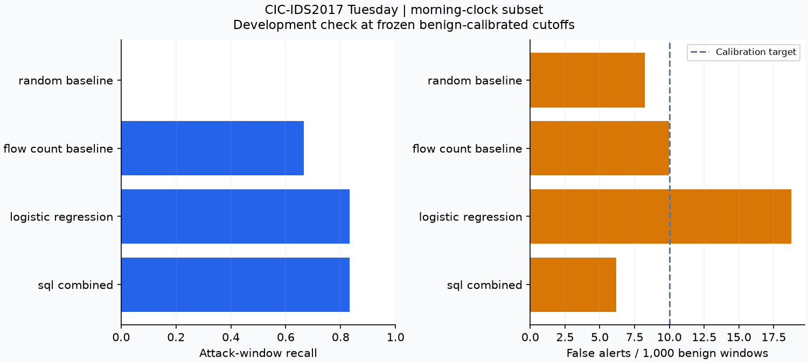
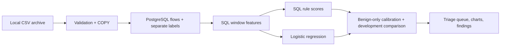

# CyberShield Analytics

**Solo project by Chase Lambuth.**

**PostgreSQL security-flow investigations, explainable triage, and a measured ML comparison.**

CyberShield turns labeled network-flow records into an inspectable investigation: validate the source, build source-by-time features in SQL, rank suspicious windows, and trace each alert to supporting flows. The research sequence asks whether added ML complexity improves on transparent SQL rules and which signals and alert budgets drive the observed results.

**Start with the [project walkthrough](docs/project_walkthrough.md).** Review the SQL transformations, three focused experiments, and measured evidence without starting a database. See the [November 8 corrected-data study](docs/corrected_study.md) for the new adapter, four-day source audit, registered protocols and current execution limits. Historical results and new support counts are kept separate.

**Power BI reporting:** open [CyberShield.pbip](power_bi/CyberShield.pbip), or double-click **Open CyberShield Power BI.cmd**. Three pages cover source quality, security investigations, and model quality/latency, with supporting-flow drill-through. The report imports one validated frozen bundle. See [setup, refresh, and reproduction](power_bi/README.md).

**Investigation agent:** double-click **Open CyberShield Agent.cmd** to open a bounded agent that chooses read-only evidence tools and produces cited briefs with visible tool traces, latency, tokens and estimated API cost. A free reference workflow is included. See [architecture and evaluation](docs/investigation_agent.md).

**SQL interface:** a local query editor with live results, CSV export, example investigations, and a schema reference, served at [http://127.0.0.1:8765](http://127.0.0.1:8765). To start it, double-click **Open CyberShield.cmd** in the project root, or run `.\.venv\Scripts\python.exe -m cybershield serve`. See [interface instructions](docs/query_workspace.md).

**The application snapshot is development-only:** one original Tuesday source file, a restricted morning-clock scoring population, and adjacent intervals that can share an attack episode. The separate [corrected-source study](docs/corrected_study.md) now ingests four days and evaluates later Wednesday/Thursday windows under a registered protocol. Both remain offline research evidence with limited, correlated positives. Friday is excluded and its earlier acquisition preview is disclosed; no pristine final holdout or production intrusion-detection effectiveness is claimed.

## Three focused research notebooks

- [Data exploration and three-source selection](notebooks/01_data_audit_and_source_selection.ipynb). Historical Tuesday audits of original and corrected CIC-IDS2017, plus a documentation-only UNSW-NB15 review. The recommended corrected adapter is now implemented in the separate study workflow; the application snapshot still uses the original.
- [Eight-model quality and latency comparison](notebooks/02_model_quality_latency.ipynb). Fixed CPU configurations, exact detection counts, training cost, single-window median/P95 latency, batch throughput and raw repetitions on one frozen feature run.
- [SQL feature ablation and alert budgets](notebooks/03_sql_feature_ablation_and_alert_budgets.ipynb). Six fixed logistic feature variants and four SQL controls at four benign-calibration budgets; matched decisions, missed positives and false-alert concentration explain sensitivity.

The notebooks contain saved tables and plots. Execution provenance and notebook hashes are recorded in `reports/research/notebook_execution.json`. See [verification instructions](docs/repository_validation.md).

See [research findings](reports/research/findings.md), [primary-source review dated October 24](docs/model_research_2026-10-24.md), and [reproduction instructions](notebooks/README.md). Source selection is independent of model scores. The corrected archive's acquisition preview read one Friday record; no Friday records enter these experiments, and Friday is not claimed to be an entirely unseen final holdout.

## Historically recorded prototype results

The [corrected-data result](docs/corrected_study.md#newly-measured-validation-result) uses a separate run and population: 1,552,419 accepted flows across four days; 2,485 known-label validation windows, including 21 positive. At the registered budget, CatBoost catches 17 positives with 18 false alerts and SQL catches 11 with 9. Strict unknown-window exclusion removes some attack-family coverage. Those results do not replace or merge with the historical numbers below.

<!-- RESULTS:START -->
Loaded **445,892 accepted flows** from **445,909 input rows**; quarantined **17**.

| Method | Caught / attack windows | False alerts / benign windows |
|---|---:|---:|
| Combined SQL rules | 5 / 6 | 21 / 3407 |
| Logistic regression | 5 / 6 | 64 / 3407 |
| Flow-count baseline | 4 / 6 | 34 / 3407 |

Run `4b812462-e408-4a6c-9c2f-f5c9f02a3494`. These are sparse, correlated development windows; no independent-attack inference is supported.
<!-- RESULTS:END -->

The SQL rules and ML use the same eligible development windows and cutoffs calibrated only on known-benign calibration windows. Preprocessing and rule reference scales use training data only. The actual development false-alert rate can differ from the calibration target. See [generated findings](reports/prototype/findings.md), [metrics](reports/prototype/metrics.csv), and [claim evidence](reports/prototype/claim_evidence.csv) for exact populations and denominators. These numbers are preserved historical observations, not a fresh database-backed rerun.



## What SQL does

- Relational constraints and checksum-tracked plain-SQL migrations.
- Five-minute `date_bin` aggregation, service-port counts, distinct destinations/ports, and packet/byte summaries.
- Elapsed-time `RANGE` windows excluding the current observation.
- Separate retrospective label construction and continuous rule scores.
- Ranked label-free `v_triage_queue` with bounded supporting-flow evidence using `LATERAL`.
- Eight initial investigations, with actual PostgreSQL execution plans for activity and burst queries.

Start with [feature engineering](sql/features/source_windows.sql), [rule scores](sql/detection/scores.sql), [burst analysis](sql/analytics/02_bursts.sql), and [error analysis](sql/analytics/08_error_analysis.sql). These files contain the analytical transformations; Python handles parsing, experiment orchestration, the ML baseline, and plotting.



## Run locally

From the project root in PowerShell, with Docker Desktop running:

```powershell
docker compose up -d --wait
.\.venv\Scripts\python.exe -m cybershield run --mode fixture
.\.venv\Scripts\python.exe -m cybershield run --mode real --archive 'C:\path\to\GeneratedLabelledFlows.zip'
.\.venv\Scripts\python.exe scripts/refresh_snapshot.py
```

Every command uses the same cross-platform Python CLI; on Linux/macOS use `.venv/bin/python`. Real mode streams only the complete Tuesday member directly from the ZIP. It does not extract or download the archive. Repeated ingestion reuses an unchanged source file; feature/experiment runs get new IDs and output directories.

## Fresh installation

Tested with Windows, CPython 3.12, Docker Desktop, PostgreSQL 16, and CPU-only execution. The dependency snapshot in `requirements.lock` records the tested Python 3.12 environment.

```powershell
python -m venv .venv
.\.venv\Scripts\python.exe -m pip install -r requirements.lock
.\.venv\Scripts\python.exe -m pip install -e . --no-deps
.\.venv\Scripts\python.exe -m cybershield configure
docker compose up -d --wait
.\.venv\Scripts\python.exe -m cybershield run --mode fixture
```

`configure` creates `.env` with a random local database password and preserves an existing file. PostgreSQL binds to `127.0.0.1:55432` and stores data in a named volume. Set documented values in `.env` if a local port or connection needs changing. Normal stop is `docker compose stop`; keep the named volume for repeat runs.

For real data, obtain the original labeled-flow archive from the official source and pass its local path. This prototype requires the source/destination/time fields; the ML-only CSV variant is unsuitable. Source acquisition, timestamps, and redistribution limits are documented in [the dataset audit](docs/dataset_audit.md).

## Verify

Verify the notebooks, curated prototype evidence and environment with the commands below. See [validation scope](docs/repository_validation.md) for the latest results.

```powershell
.\.venv\Scripts\python.exe scripts/verify_research.py
.\.venv\Scripts\python.exe -m pytest -q --tb=short --basetemp=.pytest_tmp
.\.venv\Scripts\python.exe -m pip check
.\.venv\Scripts\python.exe -m cybershield verify reports/prototype
```

Tests require the dedicated local database. They create and remove only uniquely named `cs_test_*` schemas. The fixture exercises bursts, service traffic, port diversity, malformed rows, optional nonfinite rates, duplicate headers/content, and clock boundaries. Integrity verification detects altered/missing report files; it is distinct from the planned final-test seal.

## Inspect the outputs

Each run writes `reports/runs/<mode>_<UTC time>_<id>/` with:

- Data-quality reconciliation, source hashes, warning/rejection reasons.
- Eight query outputs, triage queue, and sample supporting flow IDs/CSV record numbers.
- Window scores, decisions, metrics, fitted model, cutoffs, code/SQL/library provenance.
- Three figures, findings, a claim-evidence ledger, measured execution plans, and report hashes.

`reports/latest_real.json` and `latest_fixture.json` point to the latest complete local runs. Large run folders and fitted models stay out of Git. `scripts/refresh_snapshot.py` creates the curated tracked [prototype snapshot](reports/prototype/findings.md) and generates the results table above from its ledger.

The triage queue includes training, calibration, development, and unscored windows with an explicit `split` column. Filter to `split='development'` when inspecting evaluation examples. The view contains no ground-truth labels; error analysis joins them separately.

## Method and remaining milestones

Read [methodology](docs/methodology.md), [schema/architecture](docs/architecture.md), and [corrected-data study](docs/corrected_study.md).

The local Tuesday file contains ambiguous afternoon clock values. This version preserves all valid rows but uses only reported morning starts/completions before noon for temporal scoring. No AM/PM or UTC repair is invented. The small number of attack windows and one dominant source make count-based findings more useful than an accuracy headline.

Later milestones include release comparison, verified full-day clock interpretation, complete coverage handling, independent attack-support gates, the final cross-day protocol and enforced test freeze, registered ablations, uncertainty analysis where supported, and measured before/after optimization. Current execution plans are baseline measurements, not speedup claims.

## Dataset attribution

Source: [Canadian Institute for Cybersecurity, CIC-IDS2017](https://www.unb.ca/cic/datasets/ids-2017.html). Cite Iman Sharafaldin, Arash Habibi Lashkari, and Ali A. Ghorbani, *Toward Generating a New Intrusion Detection Dataset and Intrusion Traffic Characterization*, ICISSP 2018. Raw source data are excluded from this repository. Synthetic fixtures are explicitly marked and are never presented as real observations.

