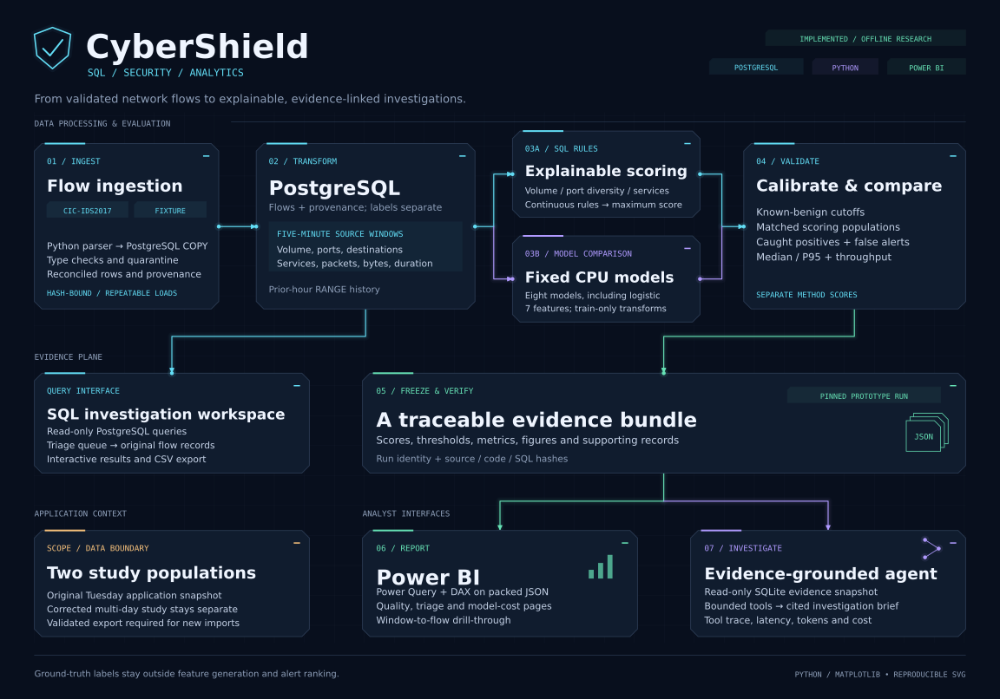
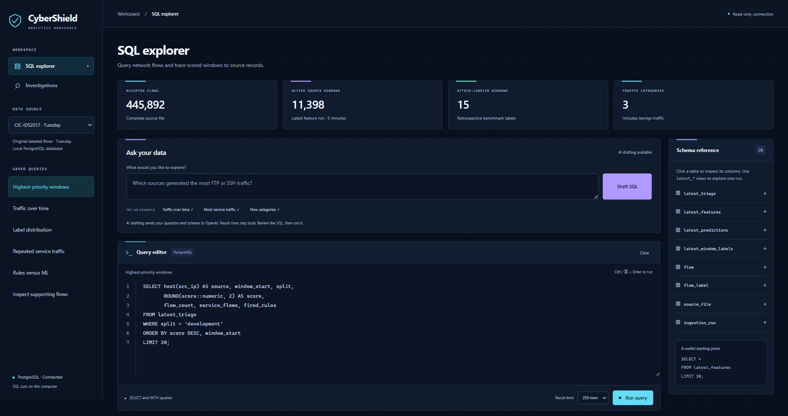
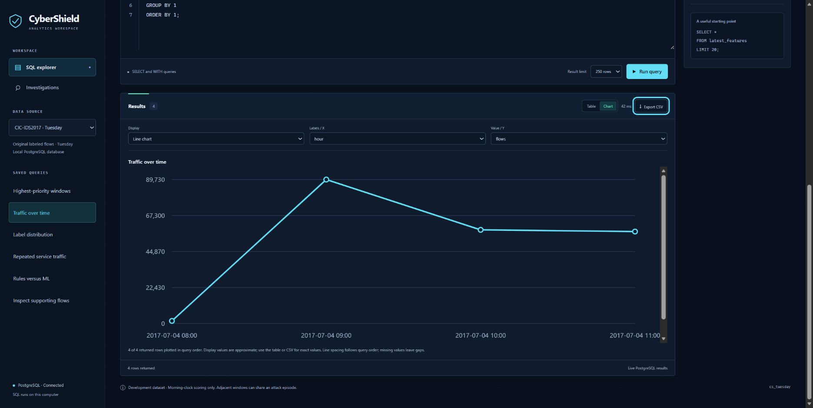
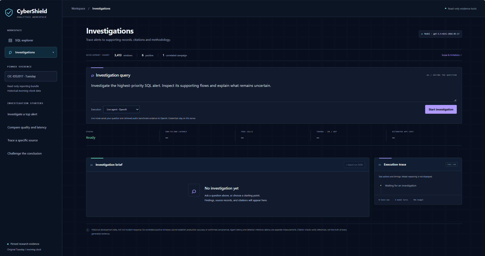
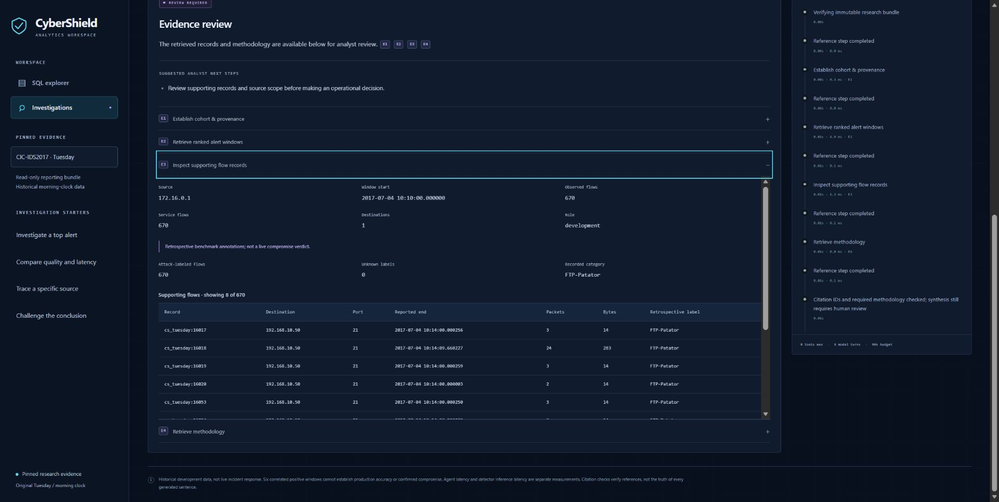
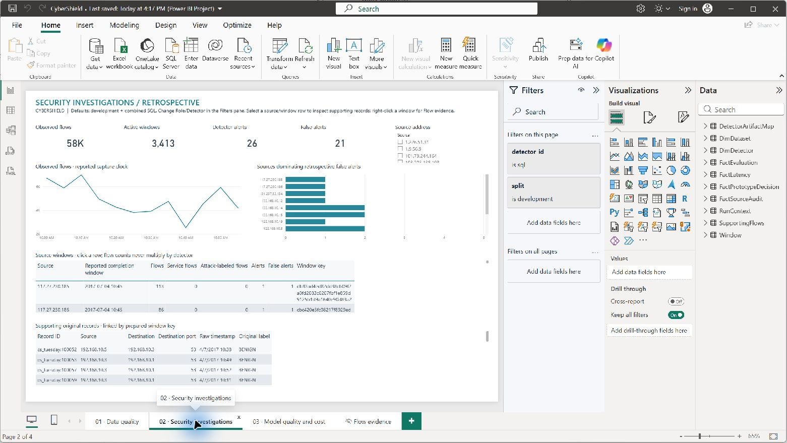
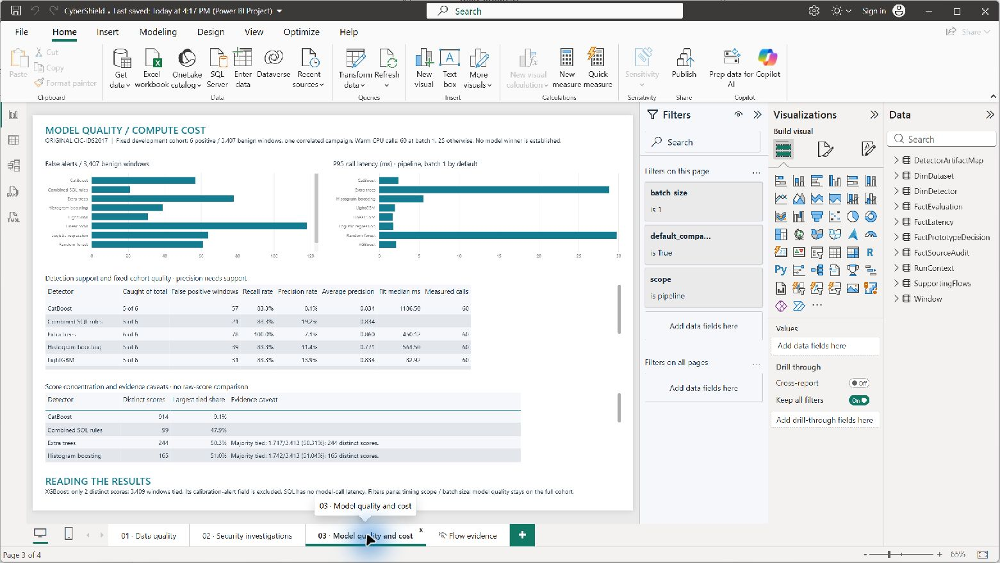
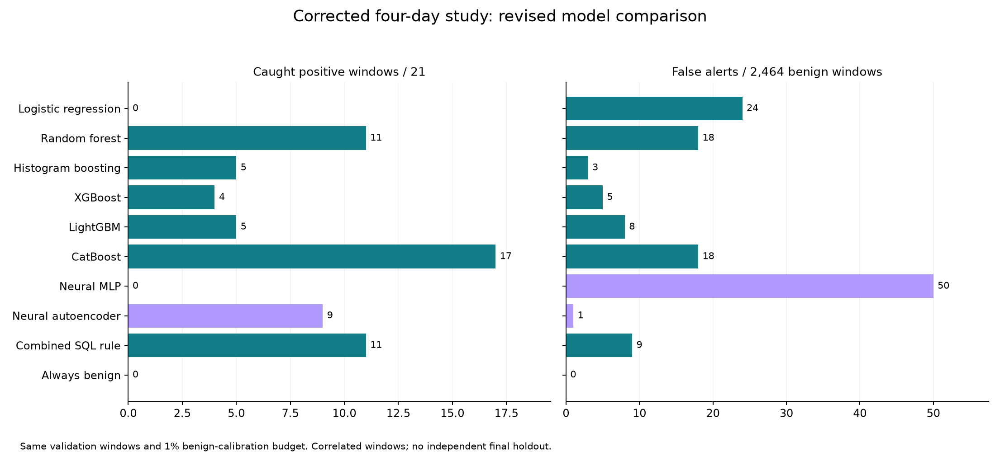
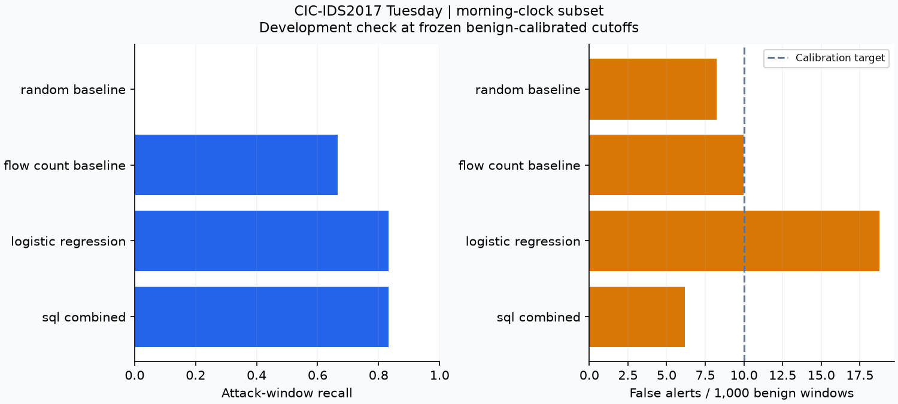

# CyberShield Analytics

**PostgreSQL security analytics, explainable alert scoring, and evidence-linked investigations.**

CyberShield analyzes network traffic with PostgreSQL, SQL-engineered features, SQL detection rules and machine learning to flag suspicious activity. An investigation agent helps trace flagged activity to supporting records, while Power BI provides interactive analytics and visualizations. Source records, scores and retrieved evidence remain linked so analysts can inspect the basis for each finding.

## Project architecture



PostgreSQL owns the relational model, temporal features and explainable rules. Python handles ingestion, controlled experiments and the investigation agent. Power BI and the agent consume a verified reporting bundle.

## In action

### Ask your data

Draft PostgreSQL from a plain-English question, review it, then run the query and switch between its table and chart. Saved example questions work without an API key; custom drafting uses the existing local OpenAI configuration.



<details>
<summary>Saved query and traffic chart</summary>



This saved example queries local PostgreSQL and makes no LLM or API calls. The table and CSV retain the exact values behind the chart.

The first hourly bucket is partial: 08:00 contains only the 08:50 and 08:55 windows (1,591 flows). Its lower count reflects incomplete hourly coverage; the rise to 09:00 does not establish a traffic surge.

</details>

### Investigation workbench

Ask an investigation question, inspect the tool trace, and open the cited evidence. The free reference workflow uses no LLM or API calls; it is separate from the recorded live-agent evaluation.

In live mode, the LLM chooses its next read-only tool from the question and previous results, including searches for ranked alerts, supporting-flow inspection, model comparisons under quality/latency constraints and methodology retrieval. Each tool result returns to the model with an evidence ID, informing further tool choices and the cited investigation brief it submits to finish the bounded workflow. The server checks citations against evidence retrieved in that run; the summary's claims still require analyst review.



Architecture-inspired interface, shown with live mode selected before execution.

<details>
<summary>Supporting flow records</summary>

The evidence panel links a source window to original flow IDs and displays benchmark annotations separately from the ranking. The alert walkthrough below traces this exact 670-flow window.



</details>

<details>
<summary>Power BI investigations and model comparison</summary>

Inspect observed traffic, development alerts, false-alert concentration and supporting records in Power BI Desktop.



Compare detection counts, false alerts, single-window latency and score ties on a fixed cohort.



</details>

The screenshots show the historical Tuesday application snapshot. The corrected multi-day research study below uses a separate population and does not automatically replace the dashboard or agent bundle.

## One alert, end to end

The highest-ranked development alert in the saved prototype is source 172.16.0.1, in the reported-completion window 10:10–10:15 on July 4, 2017. Its 670 service flows produce a combined SQL score of 223.33, above the frozen cutoff of approximately 2.00. The score is dominated by service traffic; the ranking uses no ground-truth labels.

[Follow the investigation](docs/alert_investigation.md): inspect the SQL calculation, identify the supporting source records, then check the retrospective annotations and limitations. The example can be reviewed entirely from tracked artifacts.

## Research results

### Corrected four-day development study

The study covers 1,552,419 accepted flows across Monday–Thursday. Validation contains 2,485 known-label windows: 21 positive and 2,464 benign. All methods use the same 1% known-benign calibration budget.

| Method | Caught | Missed | False alerts | Median ms | P95 ms |
|---|---:|---:|---:|---:|---:|
| Logistic regression | 0 | 21 | 24 | 1.054 | 1.608 |
| Random forest | 11 | 10 | 18 | 23.199 | 28.827 |
| Histogram boosting | 5 | 16 | 3 | 4.472 | 5.166 |
| XGBoost | 4 | 17 | 5 | 1.513 | 1.949 |
| LightGBM | 5 | 16 | 8 | 1.562 | 2.130 |
| CatBoost | 17 | 4 | 18 | 1.274 | 2.072 |
| Neural MLP | 0 | 21 | 50 | 1.047 | 1.533 |
| Neural autoencoder | 9 | 12 | 1 | 1.214 | 1.751 |
| Combined SQL rules | 11 | 10 | 9 | — | — |
| Always benign control | 0 | 21 | 0 | — | — |

CatBoost detected 17 of 21 positive windows with 18 false alerts; combined SQL rules detected 11 of 21 with 9 false alerts. The autoencoder detected 9 with 1 false alert, while the MLP detected none with 50 false alerts. These results illustrate a tradeoff between detection coverage and false-alert volume; neural models did not consistently improve detection. A common calibration budget does not guarantee the same validation false-alert rate or establish a universal winner.

The revised comparison evaluates six classical models, a two-hidden-layer MLP and a three-hidden-layer autoencoder on the existing development/validation split. The six classical models reproduce their original scores exactly.

Latency measures warm single-window CPU inference including preprocessing, with one requested thread, five warm-ups and 60 timed calls per model. It excludes SQL feature computation, database/HTTP access, cold starts and five-minute window waiting; SQL/control latency is not measured here.



These are descriptive development/validation results from correlated windows. Unknown-label exclusions reduce attack-family coverage, sources recur across roles, and no pristine final holdout or production effectiveness is claimed.

[Full results, methods and latency measurements](reports/neural_comparison_v1/README.md)

<details>
<summary>Historical Tuesday application snapshot — separate experiment</summary>

<!-- RESULTS:START -->
Loaded 445,892 accepted flows from 445,909 input rows; quarantined 17.

| Method | Caught / attack windows | False alerts / benign windows |
|---|---:|---:|
| Combined SQL rules | 5 / 6 | 21 / 3407 |
| Logistic regression | 5 / 6 | 64 / 3407 |
| Flow-count baseline | 4 / 6 | 34 / 3407 |

Run 4b812462-e408-4a6c-9c2f-f5c9f02a3494. These are sparse, correlated development windows; no independent-attack inference is supported.
<!-- RESULTS:END -->



This early prototype chart shows four selected methods and predates the eight-model comparison. CatBoost is included in the [later Tuesday benchmark](reports/research/findings.md#eight-model-development-comparison), where it caught 5/6 positive windows with 57 false alerts, and in the corrected-study chart above. The corrected study uses a different population and split; its results do not belong in this historical figure.

The cutoffs use known-benign calibration windows; preprocessing and rule scales use training data only. These saved observations are not a fresh database rerun. The prototype findings document the historical evaluation.

</details>

## Quickstart

The synthetic SQL demo requires Python 3.12 and Docker Desktop with its Linux engine running. From the cloned project root in PowerShell:

```powershell
python -m venv .venv
.\.venv\Scripts\python.exe -m pip install -r requirements.lock
.\.venv\Scripts\python.exe -m pip install -e . --no-deps
.\.venv\Scripts\python.exe -m cybershield configure
docker compose up -d --wait
.\.venv\Scripts\python.exe -m cybershield run --mode fixture
.\.venv\Scripts\python.exe -m cybershield serve
```

Open [the local SQL workspace](http://127.0.0.1:8765), select Synthetic fixture, and run an example query. This path needs no raw dataset or API key. Its generated traffic is explicitly marked synthetic; it does not reproduce the real-data results above. On Linux/macOS, use `.venv/bin/python`.

The configure command creates an ignored .env file with a random local database password. PostgreSQL binds to localhost port 55432. Stop the server with Ctrl+C and pause the database with `docker compose stop`; the named volume preserves its data.

<details>
<summary>Setup and reproduction guides</summary>

| Next step | Guide |
|---|---|
| Explore the SQL editor and datasets | [SQL workspace](docs/query_workspace.md) |
| Obtain and ingest the real source data | [Dataset audit](docs/dataset_audit.md) |
| Reproduce the corrected multi-day study | [Study commands](docs/corrected_study.md#run-commands) |
| Rebuild the Power BI report and its data bundle | [Power BI setup](power_bi/README.md) |
| Run the reference or live investigation agent | [Agent setup and evaluation](docs/investigation_agent.md) |

</details>

The reporting bundle is generated locally and excluded from Git. Power BI and the agent require that prepared bundle; the synthetic quickstart demonstrates the SQL workflow.

## Inspect the implementation

<details>
<summary>Source files and component responsibilities</summary>

| Component | What it demonstrates | Start here |
|---|---|---|
| Ingestion | Streaming validation, quarantine, row reconciliation and repeat-load idempotency | [ingest.py](src/cybershield/ingest.py) |
| SQL features | Five-minute `date_bin` aggregation, filtered counts and prior-hour `RANGE` history | [source_windows.sql](sql/features/source_windows.sql) |
| Explainable scoring | Continuous volume, port-diversity and service-traffic rules | [scores.sql](sql/detection/scores.sql) |
| Investigation lineage | Run-scoped links from windows to original flow records | [supporting_flows.sql](sql/reporting/supporting_flows.sql) |
| Natural-language SQL | Schema-grounded drafts, explicit SQL review and local result charts | [sql_assistant.py](src/cybershield/sql_assistant.py) |
| SQL performance | Equal-result source/time index comparison with measured plans, buffers and storage | [SQL lookup experiment](docs/sql_performance.md) |
| Evaluation | Training-only fitting, benign calibration and matched comparison | [study_benchmark.py](src/cybershield/study_benchmark.py) |
| Agent | Bounded read-only tools, cited briefs and execution traces | [agent.py](src/cybershield/agent.py) |

</details>

## Research notebooks

1. [Data audit and source selection](notebooks/01_data_audit_and_source_selection.ipynb): original/corrected Tuesday audits and a documentation-only UNSW-NB15 review.
2. [Model quality and prediction latency](notebooks/02_model_quality_latency.ipynb): eight fixed CPU configurations, exact confusion counts, training cost and repeated warm-call measurements.
3. [SQL feature ablation and alert budgets](notebooks/03_sql_feature_ablation_and_alert_budgets.ipynb): matched feature removals, budget sensitivity and error analysis.

The notebooks preserve the original Tuesday analysis, saved outputs and dedicated hash manifest; the corrected-data comparison supplies the current results above. Their reproduction guide covers execution instructions, interpretation limits and supporting research.

## Verification and scope

```powershell
.\.venv\Scripts\python.exe scripts/verify_research.py
.\.venv\Scripts\python.exe -m cybershield verify reports/prototype
.\.venv\Scripts\python.exe -m cybershield verify reports/neural_comparison_v1 --registration-sha256 f3382bd99e8d30e43fb3fc8b693d774e08e542901bcde2f1bdad552e3887a98c
.\.venv\Scripts\python.exe -m pip check
.\.venv\Scripts\python.exe -m pytest -m "not integration and not reporting_bundle" -q
```

The validation workflow checks saved artifacts, portable tests, isolated PostgreSQL integration tests and the synthetic pipeline/HTTP workspace. Bundle-dependent agent tests are explicitly marked and run separately against a prepared local reporting bundle. The [validation guide](docs/repository_validation.md) records local checks, reproduction commands and the distinction between local checks and a hosted CI run.

Source: [Canadian Institute for Cybersecurity, CIC-IDS2017](https://www.unb.ca/cic/datasets/ids-2017.html). Cite Sharafaldin, Lashkari and Ghorbani, *Toward Generating a New Intrusion Detection Dataset and Intrusion Traffic Characterization*, ICISSP 2018. Corrected-release attribution is documented in the study guide.

Raw source archives, credentials, generated models and large run folders are excluded from Git. Friday records are excluded from these studies; a prior acquisition preview is disclosed, so Friday is not described as an entirely unseen final holdout.
