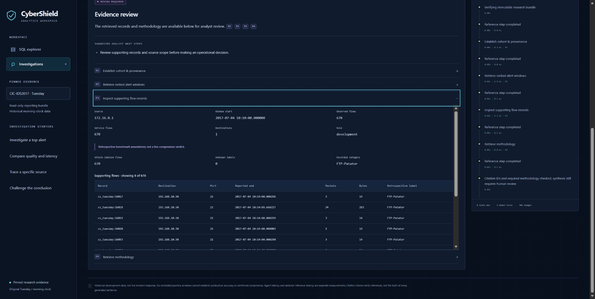

# From a SQL alert to its supporting flows

**Investigation question:** Why did `172.16.0.1` rank first, and which records support that alert?

This example uses the saved original Tuesday development experiment. Its queue, feature snapshot and record references are tracked, so the evidence can be inspected without PostgreSQL or the raw archive. The [corrected multi-day study](corrected_study.md) is a separate experiment.

## Where this case fits

| Evidence | Population | Role in the project |
|---|---|---|
| This SQL alert and the current investigation workbench | Original Tuesday morning-clock snapshot | Explain the score and trace its supporting records. |
| [Eight-model Tuesday comparison](../reports/research/findings.md#eight-model-development-comparison) | 6 positive and 3,407 benign development windows | Compare fixed model configurations, including CatBoost. |
| [Corrected four-day study](corrected_study.md) | 21 positive and 2,464 benign validation windows | Examine later-day performance under a separately registered protocol. |

The early prototype comparison chart contains four selected methods. CatBoost appears in the later benchmarks; its absence from that early chart does not mean it was excluded from the project. This case remains tied to its original run and source records.

## 1. Identify the ranked window

The first row of [the saved triage queue](../reports/prototype/triage_queue.csv) records:

| Field | Recorded value |
|---|---|
| Experiment | `4b812462-e408-4a6c-9c2f-f5c9f02a3494` |
| Feature run | `9d3df5df-7354-4e74-af40-4df1358ea69e` |
| Rank / role | `1` / `development` |
| Source | `172.16.0.1` |
| Reported-completion window | July 4, 2017, **[10:10:00, 10:15:00)** |
| Observed flows / service flows | **670 / 670** |
| Distinct destination addresses / ports | **1 / 1** |
| Combined SQL score | **223.3333** |
| Decision | Alert |

The time is the preserved capture clock; its timezone is unknown. Membership uses reported flow completion, with an inclusive start and exclusive end. Accepted afternoon records remain outside this prototype's morning-clock scoring population.

The [triage view](../sql/migrations/001_core.sql) ranks combined scores without a label join. In **SQL explorer**, select **CIC-IDS2017 · Tuesday** and inspect the recorded run:

```sql
SELECT rank, src_ip, window_start, split, score,
       flow_count, service_flows, unique_ports,
       unique_destinations, fired_rules
FROM v_triage_queue
WHERE experiment_id = '4b812462-e408-4a6c-9c2f-f5c9f02a3494'::uuid
  AND split = 'development'
ORDER BY rank
LIMIT 5;
```

These queries bind to saved run/source IDs. A newly reproduced run has its own IDs; use those when inspecting your own database. The synthetic fixture does not contain this real-data example.

## 2. Explain the score

The [rule implementation](../sql/detection/scores.sql) divides observed counts by training-benign reference scales, then takes the maximum component. The [saved protocol](../reports/prototype/development_protocol.json) records the scales and calibrated cutoffs.

| Component | Observed count | Training reference scale | Normalized score |
|---|---:|---:|---:|
| Volume | 670 flows | 517.76 | 1.2940 |
| Port diversity | 1 destination port | 19 | 0.0526 |
| Service traffic | 670 flows to ports 21/22 | 3 | 223.3333 |

The port-diversity component's minimum-flow gate is satisfied. The combined score is therefore **223.3333**, dominated by service traffic, against the frozen combined cutoff of **2.0000000000000004**. The volume and service rules also cross their own individual cutoffs, which explains the queue's `fired_rules` list.

The [feature snapshot](../reports/research/snapshot/window_scores.csv) records a prior active-window mean of **597.09** flows and a volume-change ratio of **1.1221**. This window's ranking is driven by service concentration, rather than requiring a large increase over its recent volume. That historical mean describes observed active windows and does not establish complete sensor coverage.

The score is a normalized rule value. It is not a probability of compromise.

## 3. Follow the record lineage

The [saved evidence references](../reports/prototype/triage_evidence.csv) list five original record references for this window:

| Normalized flow ID | Source-file ID | Source record number |
|---|---|---:|
| `16017` | `1` | 16018 |
| `16018` | `1` | 16019 |
| `16019` | `1` | 16020 |
| `16020` | `1` | 16021 |
| `16053` | `1` | 16054 |

These are five references from the 670-flow window. Source-file ID `1` is bound in [the ingestion audit](../reports/prototype/data_quality.json) to `TrafficLabelling /Tuesday-WorkingHours.pcap_ISCX.csv` and its SHA-256 digest. Generated flow IDs are database identifiers; the source ID and source record number connect them back to the archived CSV.

The agent's [saved `alert_to_flows` evaluation](../reports/agent_evaluation/live.json) also contains eight supporting records under the first result's evidence. Those displayed records go to **`192.168.10.50:21`**. For example, flow `16017` has reported completion `10:14:00.000256`, 3 packets and 14 bytes; flow `16018` has completion `10:14:09.660227`, 24 packets and 283 bytes. Both completion times fall inside the selected window.

The corresponding read-only inspection query is:

```sql
SELECT flow_id, source_id, row_number,
       host(dst_ip) AS destination, dst_port,
       reported_end, packets, bytes
FROM flow
WHERE source_id = 1
  AND src_ip = '172.16.0.1'::inet
  AND clock_usable
  AND reported_end >= TIMESTAMP '2017-07-04 10:10:00'
  AND reported_end <  TIMESTAMP '2017-07-04 10:15:00'
ORDER BY flow_id
LIMIT 5;
```

Reporting-bundle preparation additionally checks run-scoped window membership through [supporting_flows.sql](../sql/reporting/supporting_flows.sql). The example query above uses the recorded source-file identity directly.

## 4. Check annotations after ranking

After ranking, the snapshot's separate targets record **670 attack-labeled flows**, **0 unknown-label flows**, and category **FTP-Patator** for this window. This makes it a true positive under the benchmark's retrospective window target. Those annotations did not generate its feature values, score or rank.

The application exposes the same evidence as an expandable panel:



This screenshot comes from the deterministic reference workflow, which makes no LLM calls. The separately recorded live-agent evaluation uses the same frozen evidence bundle; its timings and generated brief belong to that evaluation run.

## Review the case in the current interface

1. In **SQL explorer**, select **CIC-IDS2017 · Tuesday** and use **Highest-priority windows** to explore the active run. Use the run-specific queries above when checking this saved case. The synthetic fixture contains a different population.
2. Open **Investigations** from the same sidebar, choose **Reference demo · no LLM**, and select **Investigate a top alert**. Start the investigation and expand **Inspect supporting flow records** to check the source, window, record IDs and separate annotations. The agent reads its pinned reporting bundle; changing the SQL explorer's dataset does not change that bundle.
3. Keep SQL drafting separate from evidence retrieval. **Ask your data** proposes SQL from a question and schema; review the proposal before running it. The investigation agent instead uses fixed read-only evidence tools. Neither path retrains a detector or changes this case's frozen scores.

The refreshed [workbench overview](assets/investigation_workspace.jpg) and evidence image above show the default architecture-inspired dark theme and shared navigation. They capture the free reference workflow, not a new live-agent evaluation.

## Finding and limits

The alert is explainable: concentrated service traffic produces a high SQL score, and stable source-record references support inspection of the underlying flows. An analyst can reproduce the calculation and review the benchmark annotations separately.

This case demonstrates score interpretation and record lineage. Model selection requires the separate comparisons: on the corrected validation population, CatBoost caught 17/21 positive windows with 18 false alerts, while the combined SQL rule caught 11/21 with 9. Those aggregate outcomes do not establish how either method would score this original Tuesday window under a different protocol.

This is one correlated window from a historical laboratory capture. The prototype's six positive development windows share a campaign; they do not establish six independent incidents, production detection accuracy or a live compromise verdict. A matching benchmark label does not establish intent or validate every statement an agent might generate.

[Back to the project overview](../README.md) · [Methodology](methodology.md) · [SQL workspace](query_workspace.md)
