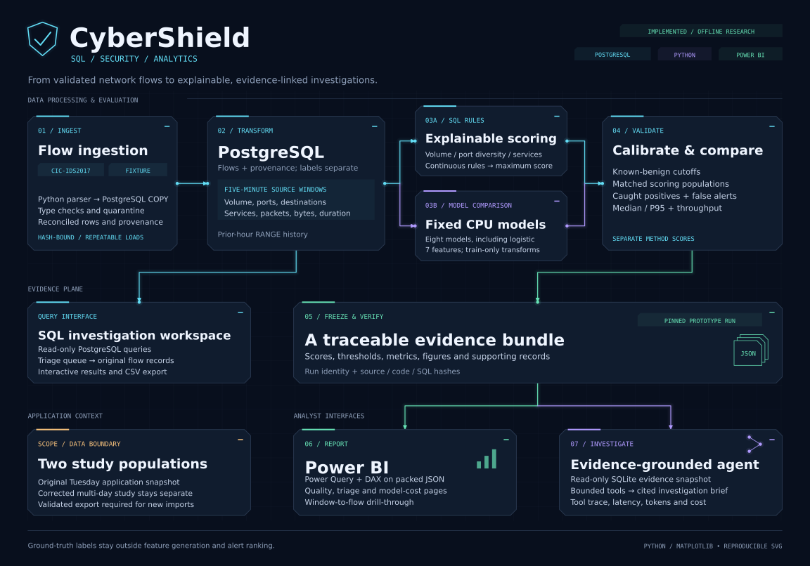
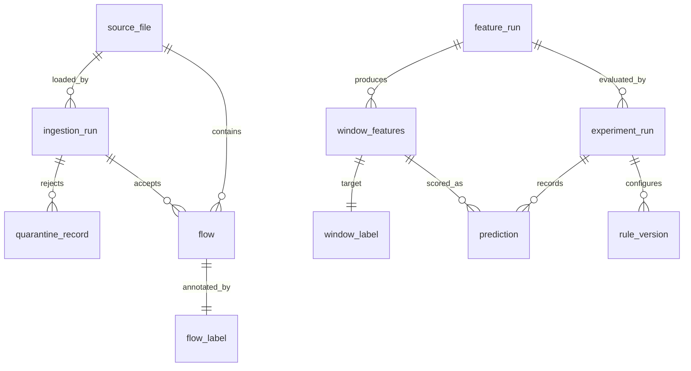

# Architecture and database grains



The diagram covers ingestion, PostgreSQL feature engineering, separate SQL/ML evaluation, and the investigation interfaces. The corrected-data study remains separate from the prototype bundle used by Power BI and the agent.

The SQL workspace also offers question-to-SQL drafting and local result charts. Its drafting model receives schema definitions and the question, then proposes SQL for user review. Query execution remains in the existing restricted PostgreSQL reader; the investigation agent retains its separate fixed evidence tools. See [workspace boundaries](query_workspace.md#ask-with-plain-english).

Regenerate the vector figure using the existing Matplotlib dependency:

```powershell
.\.venv\Scripts\python.exe scripts/build_architecture.py
# Optional local PNG preview:
.\.venv\Scripts\python.exe scripts/build_architecture.py --png .tmp/architecture_preview.png
```

The editable drawing source is [build_architecture.py](../scripts/build_architecture.py). The SVG is the canonical repository asset; PNG previews are optional.



- **Source grain:** uncompressed file hash + archive member name; archive hash recorded separately.
- **Flow grain:** one accepted source row, uniquely identified by source + CSV record number. Hash-equal content is flagged but retained.
- **Feature grain:** run + recorded source IP + five-minute reported-completion-proxy bin.
- **Prediction grain:** experiment + source + bin + method. Ground truth is stored separately.
- **Triage evidence:** source/run provenance and sample normalized flow IDs; the evidence query filters the exact feature run's source files.

Every schema migration is plain SQL with a recorded checksum. Fixture, Tuesday real data, and generated test schemas are isolated within the dedicated `cybershield` database. PostgreSQL uses a named Docker volume and binds only to localhost port 55432. Python uses `COPY FROM STDIN`; the container never needs access to a Windows source-file path.

## SQL responsibilities

PostgreSQL performs temporal binning (`date_bin`), distinct counts, service-port counts, byte/packet/duration aggregation, retrospective target aggregation, elapsed-time history (`RANGE`), score normalization, maximum-score combination, ranking, and evidence selection (`LATERAL`). Python fits the baseline, selects deterministic cutoffs, calculates metrics, and renders charts.

Eight prototype queries cover activity, bursts, port diversity, service activity, category profiles, aggregate transitions, source concentration, and post-scoring errors. A [measured synthetic evidence lookup](sql_performance.md) documents the existing source/time index, equivalent results, buffer use and storage cost. Real-data optimization and rarity analysis remain later milestones.

