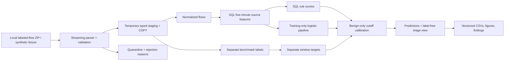
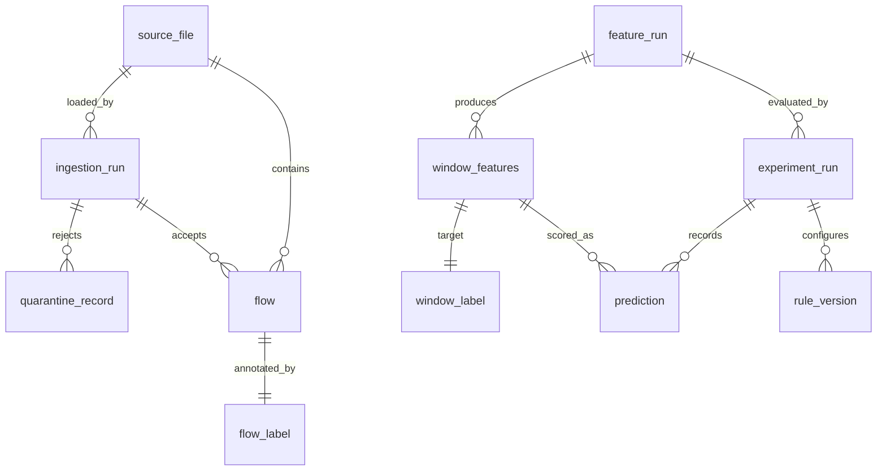

# Architecture and database grains

- **Source grain:** uncompressed file hash + archive member name; archive hash recorded separately.
- **Flow grain:** one accepted source row, uniquely identified by source + CSV record number. Hash-equal content is flagged but retained.
- **Feature grain:** run + recorded source IP + five-minute reported-completion-proxy bin.
- **Prediction grain:** experiment + source + bin + method. Ground truth is stored separately.
- **Triage evidence:** source/run provenance and sample normalized flow IDs; the evidence query filters the exact feature run's source files.

Every schema migration is plain SQL with a recorded checksum. Fixture, Tuesday real data, and generated test schemas are isolated within the dedicated `cybershield` database. PostgreSQL uses a named Docker volume and binds only to localhost port 55432. Python uses `COPY FROM STDIN`; the container never needs access to a Windows source-file path.

## SQL responsibilities

PostgreSQL performs temporal binning (`date_bin`), distinct counts, service-port counts, byte/packet/duration aggregation, retrospective target aggregation, elapsed-time history (`RANGE`), score normalization, maximum-score combination, ranking, and evidence selection (`LATERAL`). Python fits the baseline, selects deterministic cutoffs, calculates metrics, and renders charts.

Eight prototype queries cover activity, bursts, port diversity, service activity, category profiles, aggregate transitions, source concentration, and post-scoring errors. Rarity analysis and measured query-optimization studies remain later milestones.

