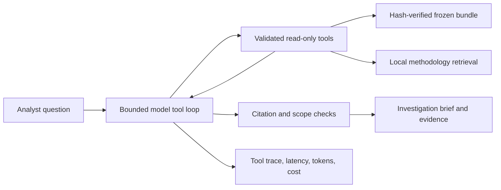

# CyberShield investigation agent

Ask a question, watch the evidence tools, inspect the citations, export the run. This is a bounded agent over the same frozen research bundle used by Power BI.

## Open

Double-click **Open CyberShield Agent.cmd**. The workbench opens at http://127.0.0.1:8766/investigate. It works without PostgreSQL; SQL exploration remains available separately. To serve manually:

```powershell
.\.venv\Scripts\python.exe scripts/serve_agent.py
```

Live mode uses local `config.json` (`API_KEY` and `OPENAI_API_BASE`) or `OPENAI_API_KEY` from the environment. Local configuration is excluded from Git. `config.example.json` contains placeholders only. Credentials stay on the server; the browser receives model name and configuration status. This adapter accepts only `https://api.openai.com/v1` and refuses redirects.

The default model is the pinned `gpt-5.4-mini-2026-03-17`. Set `CYBERSHIELD_AGENT_MODEL` to change it deliberately. Other models must support strict function tools on the Responses API. Cost is reported as unknown for models without configured rates; no different-model cost is invented.

Live runs transmit the question and bounded public benchmark evidence to OpenAI and incur API usage. Reference mode uses deterministic planning, performs real evidence-tool queries, and makes no model calls. It demonstrates integration, not LLM reasoning or LLM evaluation performance.

## Workflow



The model decides which tool to call next based on prior results. Tools establish provenance, search label-free development alerts, inspect exact windows and up to eight original flows, filter model quality/P95 tradeoffs, and retrieve ranked methodology passages. Retrieval is transparent lexical overlap over a small curated knowledge base; no embedding model or vector database is claimed.

The application executes fixed parameterized SQLite queries against a verified in-memory snapshot with `PRAGMA query_only=ON`. It exposes no arbitrary SQL, shell, file access, network response, retraining, or blocking tool. PostgreSQL features and benchmark computations remain upstream. Existing detector scores and notebooks are not changed.

Every tool output carries a run-local evidence ID, source hashes, and any query/parameters. The model submits a structured brief through `finish`. The server checks the schema, citation membership, and citation of cohort/methodology evidence. These checks prevent fabricated references; they do **not** prove every natural-language claim is true. Analysts must review the synthesis. Retrospective labels never establish a live compromise verdict.

Runs allow six model turns, eight tool calls, and a 90-second elapsed budget checked between steps. Individual requests use a timeout of at most 35 seconds or the remaining budget. There are no automatic retries, two concurrent runs maximum, and twenty runs retained in memory. Partial evidence survives budget failure. A transport timeout is not an upstream cancellation guarantee. Local run JSON is saved under ignored `reports/agent_runs/`; export is also available in the interface.

## Example investigations

1. Ask **“Investigate the highest-priority SQL alert. Inspect its supporting flows and explain what remains uncertain.”**
2. Review the adaptive tool trace, then open the cited window and flow evidence. Labels are excluded from ranking so that alert order never depends on retrospective ground truth.
3. Ask **“Compare models with at most 40 false positives and pipeline P95 under 2 ms.”** The brief reports the applied constraints, measured detector latency, and tie caveats.
4. Ask about an absent source. The agent reports insufficient evidence rather than substituting a different source.
5. Use Power BI for aggregate reporting. The run export records provenance, tool calls, latency and token use for each investigation.

Agent wall time includes model/tool work and may include cold bundle loading. Detector P95 comes from the existing warm CPU benchmark. They measure different workloads. Token usage comes from provider responses; cost uses standard GPT-5.4 mini rates checked November 2, 2026: input $0.75, cached input $0.075, output $4.50 per million. It is an estimate excluding taxes, not a billing receipt.

## Evaluation

```powershell
# Offline unit and boundary checks; no paid calls
.\.venv\Scripts\python.exe -m pytest tests/test_agent.py tests/test_workspace.py -m 'not integration' --basetemp=.tmp/pytest_agent -q
# Free workflow integration baseline
.\.venv\Scripts\python.exe scripts/evaluate_agent.py --mode reference
# Six explicit paid live scenarios
.\.venv\Scripts\python.exe scripts/evaluate_agent.py --mode live
```

`evals/agent_cases.json` covers alert-to-flow membership, quality/latency constraints, an absent source, tie-sensitive claims, destructive requests, and credential prompt injection. Results under `reports/agent_evaluation/` retain each tool trace, deterministic rubric checks, latency, token use and estimated cost. The reference planner is deliberately simple; its results are reported separately and are not used to claim live model accuracy. One run per heterogeneous scenario is a small smoke evaluation, not a statistical accuracy estimate or a production-readiness certification. Offline tests also use a fake planner to verify fail-closed behavior when citations, tool names, or methodology are invalid.

The completed evaluation and its limits are recorded in [the results summary](../reports/agent_evaluation/README.md). Both the final live suite and the separately labeled reference suite passed all six cases. The initial failed runs are archived locally; their results remain disclosed in that summary.

## Design scope

The agent supports tool orchestration, evidence retrieval, structured outputs, provenance-linked reports, and cost/latency instrumentation. Its tools are read-only and bounded to the verified research bundle. Additional frameworks or agents require a measured need. The saved evaluation supports only the documented scenarios; production deployment and autonomous response have not been evaluated.

The interface design draws on [Linear](https://linear.app/)'s restrained dark surfaces, fine borders, and compact typography, with CyberShield's own shield mark, amber/olive palette, layouts, and wording.

Implementation references: [OpenAI function calling](https://developers.openai.com/api/docs/guides/function-calling), [model capabilities and pricing](https://developers.openai.com/api/docs/models/gpt-5.4-mini). Research limitations remain in `power_bi/README.md`.
