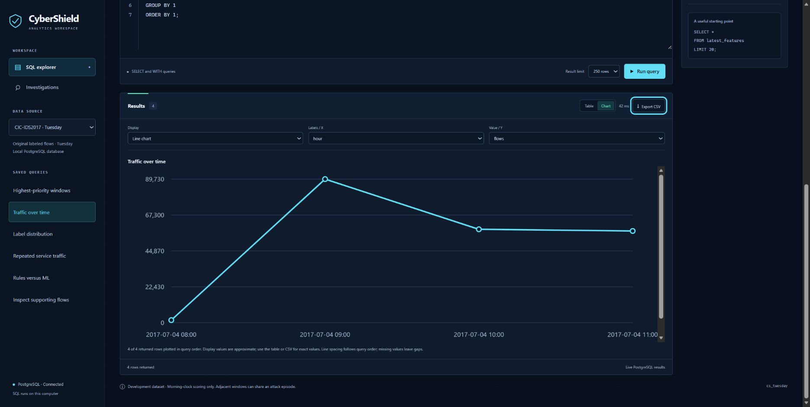

# SQL workspace: questions, queries and charts

Open **http://127.0.0.1:8765** while the local server is running. To reopen it later, double-click **Open CyberShield.cmd** in the project folder. That launcher reuses a healthy workspace or starts PostgreSQL and the local server, then opens the page.

To start it manually from the project directory:

```powershell
docker compose up -d --wait
.\.venv\Scripts\python.exe -m cybershield serve
```

Keep that terminal running. Open the page in a browser on this computer.

## Explore

1. Select the Tuesday real dataset or the clearly marked synthetic fixture.
2. Choose an example from the sidebar, or type your own SQL in the editor.
3. Click **Run query**, or press **Ctrl+Enter** (**Cmd+Enter** on macOS).
4. Inspect the returned table and elapsed time, or switch to **Chart** for numeric results. Expand a table in the schema reference to see its columns.
5. Click **Export CSV** to download the displayed results. The selected result limit also applies to exports.

Start with:

```sql
SELECT label, COUNT(*) AS flows
FROM flow_label
GROUP BY label
ORDER BY flows DESC;
```

Use `latest_features`, `latest_window_labels`, `latest_predictions`, and `latest_triage` for the most recent completed experiment. Their joins prevent repeated experiment runs from inflating a simple exploration query. `flow` retains the original source-record grain. The example triage query restricts results to development windows.

## Ask with plain English

The **Ask your data** panel drafts PostgreSQL from a question such as "Which sources generated the most FTP or SSH traffic?" It proposes a query, explains its scope and recommends chart fields. Review the SQL in the editor, then click **Run query** to execute it. Drafting itself never executes the proposed SQL.

Custom questions use the same ignored local OpenAI API configuration and configured model as the investigation agent. Only the question, selected schema's table/column definitions and allowed functions are sent for drafting; query results are not uploaded. The interface displays this boundary before submission. Credentials remain on the server. Each draft uses one provider request with a 35-second timeout, no automatic retries and at most two simultaneous drafts. Live drafting uses paid API access; no paid requests are made by the test suite.

The three **Try an example** questions load explicitly labeled saved SQL without an API call. They work with either dataset and require no API key. They demonstrate the question-to-query-to-chart workflow without claiming AI generated those examples.

Generated SQL passes the same table/function/parser checks as manually entered SQL before reaching the editor. When run, it is checked again and executes only through the restricted database reader. A syntactically permitted query can still answer the wrong question: review grouping, joins, run scope, clocks and denominators. Unsupported questions, provider failures and rejected SQL leave the current query unchanged.

This is a single-question SQL drafting feature, separate from the investigation agent's bounded evidence tools. It does not add arbitrary PostgreSQL execution to that agent or give the drafting model database credentials or query results. Provider integration tests use mocked responses; the recorded chart preview uses a saved example against the actual local PostgreSQL data.

## Chart the returned rows

Switch between **Table** and **Chart**, then select bar or line display, the label/X column and the numeric value/Y column. Charts are rendered locally with SVG and need no chart library or external assets. Saved question examples and AI drafts with numeric output can open the chart after the reviewed SQL is run.

Charts preserve the returned row order and never silently aggregate categories, fill missing time bins or interpret labels as independent incidents. Bar charts show at most 30 rows and line charts at most 100; additional rows remain in the table and CSV. The caption discloses skipped missing/nonnumeric/unsafe values, display caps and truncated SQL results. Line charts retain the positions of omitted rows and break the line at those gaps. Numeric display is approximate; exact decimal text remains available in the table and export. A line's spacing represents query row order, not measured elapsed time between observations.



This preview uses the historical Tuesday morning-clock application population. It is separate from the corrected four-day model study. The same four hourly aggregates remain available in the table.

The 08:00 bucket is a partial hour with only the 08:50 and 08:55 windows, totaling 1,591 flows. The later buckets contain full hours of observed windows; the initial rise is a coverage difference and should not be interpreted as evidence of a traffic surge.

## Query behavior

- One `SELECT` or `WITH … SELECT` statement per request, including joins, aggregates, unions, and window expressions.
- Up to 500 returned rows and a five-second database timeout. The interface marks truncated results explicitly.
- Common analytical functions are supported. Unsupported functions, cross-dataset relations, write operations, and locking clauses return a clear message.
- Exact numeric/decimal values are returned as text to preserve their precision. Dates use the stored capture clock, without an invented timezone.
- SQL output is rendered as text. It cannot inject HTML into the table.

The server binds only to loopback. A separate `cybershield_workspace_reader` login has SELECT-only grants on the listed dataset objects, default read-only transactions, and no owner/superuser privileges. User queries never execute as the ingestion owner. A parser validates the query shape, and PostgreSQL privileges independently prevent data modification. Reader credentials are generated into ignored `.env` during startup and never sent to the browser.

The browser uses a per-process page token for query and drafting requests, with same-host validation and no external scripts/assets. These are controls for a local development interface; network hosting/authentication is outside this release.

## Dataset interpretation

The interface queries the existing development database. It does not ingest new data, change thresholds, or run a final evaluation. The real dataset's temporal views cover the same restricted morning-clock population as the prototype. Fifteen attack-labeled windows in that population share the recorded source; counts do not represent independent attack episodes. The label-distribution example covers the complete accepted Tuesday file, including rows excluded from temporal scoring.

## Visual style

Both pages use the architecture-inspired dark theme by default: a deep navy background, cyan, teal and restrained violet accents, and a subtle grid. The original navigation, query editor, result views and evidence-workbench layout are retained. Teal identifies evidence and status, violet marks investigation and drafting actions, and cyan marks SQL execution. No decorative telemetry or extra panels are introduced.

Both views share the same sidebar and header templates. SQL explorer always appears above Investigations; sidebar width, navigation buttons, saved-query/starter buttons and spacing match across views, including responsive layouts. Only the active state and workspace-specific content change when switching tabs.

The design review used [NN/g's task-focused AI interface guidance](https://www.nngroup.com/articles/ai-chat-not-the-answer/), [visual hierarchy guidance](https://www.nngroup.com/articles/visual-hierarchy-ux-definition/) and [Carbon's data-table guidance](https://www.carbondesignsystem.com/building-blocks/core/components/data-table/guidelines). Community complaints about repetitive gradients and card layouts were treated as aesthetic observations, not a universal test of AI-generated design. Familiar controls and the established layout are preserved.

## Stop or restart

For a manually started server, press **Ctrl+C** in its terminal. For the double-click/background launcher, use the process ID in `.workspace.pid` to stop that workspace process. Stop PostgreSQL with `docker compose stop` when finished; its named volume preserves data.

For a fresh environment, install dependencies from `requirements.lock`. Startup applies migration `002_query_workspace.sql` to existing fixture/Tuesday schemas. If data are not yet loaded, first run the corresponding prototype pipeline.

Implementation references: [Flask](https://flask.palletsprojects.com/en/stable/quickstart/), [PostgreSQL read-only transactions](https://www.postgresql.org/docs/16/sql-set-transaction.html), [server-side cursors](https://www.postgresql.org/docs/16/sql-declare.html), [SQLGlot parser](https://github.com/tobymao/sqlglot), [OpenAI function calling](https://developers.openai.com/api/docs/guides/function-calling).

