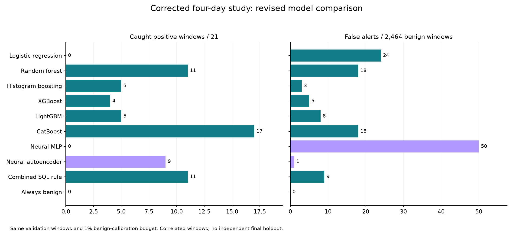
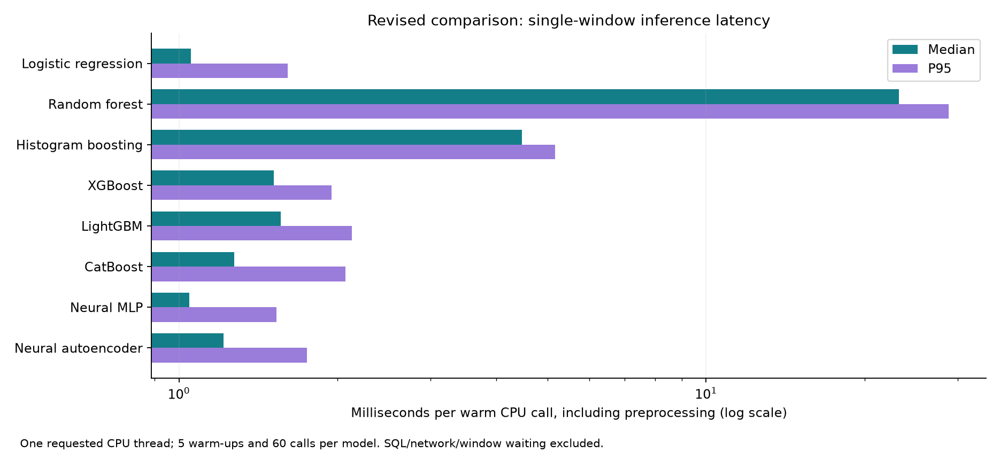

# Revised model comparison

Measured November 21, 2026. Linear SVM and Extra Trees are replaced by a neural MLP classifier and neural autoencoder in the current corrected-data comparison. Logistic regression remains a transparent baseline; the other five retained classical models, combined SQL rule and always-benign control use the same windows and operating-budget definitions.

## Results

All methods score **2,485 known-label validation windows: 21 positive and 2,464 benign**. The 1% known-benign calibration budget uses the same separate 152 benign windows, allowing at most one calibration false alert. It does not constrain validation false alerts to 1%.

| Method | Caught / 21 | Missed / 21 | False alerts / 2,464 benign | Median CPU ms | P95 CPU ms |
|---|---:|---:|---:|---:|---:|
| Logistic regression | 0 | 21 | 24 | 1.054 | 1.608 |
| Random forest | 11 | 10 | 18 | 23.199 | 28.827 |
| Histogram boosting | 5 | 16 | 3 | 4.472 | 5.166 |
| XGBoost | 4 | 17 | 5 | 1.513 | 1.949 |
| LightGBM | 5 | 16 | 8 | 1.562 | 2.130 |
| CatBoost | 17 | 4 | 18 | 1.274 | 2.072 |
| Neural MLP | 0 | 21 | 50 | 1.047 | 1.533 |
| Neural autoencoder | 9 | 12 | 1 | 1.214 | 1.751 |
| Combined SQL rules | 11 | 10 | 9 | — | — |
| Always benign control | 0 | 21 | 0 | — | — |



The autoencoder produced fewer false alerts than CatBoost or SQL at the cost of missing more positive windows. The MLP failed to detect positive validation windows at its calibrated cutoff despite fitting its training objective without a convergence warning. A low training loss does not establish generalization. Neither neural architecture consistently improves on the existing methods; all outcomes are retained without retuning after viewing these validation results.

## Models and data boundaries

The seven existing SQL-engineered features are flow count, unique ports, unique destinations, service flows, packets, bytes and mean duration. No source address, timestamp or ground-truth annotation is an input feature. Training contains 2,906 known-label windows: 24 positive and 2,882 benign.

- **Neural MLP:** 7 → 32 → 16 → binary probability; balanced training sample weights. Implemented with scikit-learn's [MLPClassifier](https://scikit-learn.org/stable/modules/generated/sklearn.neural_network.MLPClassifier.html).
- **Neural autoencoder:** 7 → 16 → 4 → 16 → 7 reconstruction; network weights fit to the 2,882 benign training windows only. The anomaly score is mean squared reconstruction error, with larger values indicating greater deviation. Implemented with the multi-output [MLPRegressor](https://scikit-learn.org/stable/modules/generated/sklearn.neural_network.MLPRegressor.html).

Both pipelines fit median imputation, `log1p` and standardization on known training windows only. The autoencoder's preprocessing uses all known training windows, while its network training uses only benign rows. Both use ReLU hidden layers, Adam, batch size 64, learning rate 0.001, L2 alpha 0.001 and a maximum of 200 iterations. Loss-based stopping observes training loss only: tolerance 0.0001 and 20 iterations without sufficient improvement, with `early_stopping=False`. No calibration or validation labels drive neural fitting or early stopping. The final MLP fit used 99 iterations and the autoencoder 109; all 24 timed fits returned zero warnings.

One fixed architecture per neural model was declared in [the protocol](protocol.json) before the completed run. Three fits per model use the same seed, 1729, to measure fit cost; these are not independent-seed robustness experiments. Scores come from the final repeat, with no best-repeat selection. The six retained classical models reproduced the parent scores exactly; see [reconciliation](retained_model_reconciliation.json).

## Latency and fit cost



All eight fitted models were timed again on the same machine with one requested CPU thread, randomized interleaving and `perf_counter_ns`. Single-window results use five warm-ups and 60 timed calls. Batches of 32, 256 and all 2,485 validation windows use five warm-ups and 25 timed calls each. Batch rows are sampled uniformly without replacement within each call; all methods receive the same raw batches. P95 is the empirical 95th percentile, not a confidence bound.

Both full-pipeline and model-only timings are saved. The table shows the full pipeline, including preprocessing and model scoring. Batch timings report milliseconds per **batch**, not per row. SQL feature construction, database access, HTTP, model loading/serialization, cold starts, agent calls and waiting for a five-minute window are excluded. SQL control scores are reused from the verified parent; they have no comparable inference measurement here. These measurements describe this Windows CPU environment and can vary with host load.

The median of three fit times was 3,341.732 ms for the MLP and 3,783.528 ms for the autoencoder. All methods' exact fit medians are in [quality_latency.csv](quality_latency.csv), with individual fits in [raw_fit_times.csv](raw_fit_times.csv). See [raw inference calls](raw_latency.csv), [batch/scope summaries](latency_by_batch.csv) and [hardware/package versions](environment.json).

## Provenance and limitations

This revision was requested after inspection of the original validation outcomes: Linear SVM caught 0/21 positives and Extra Trees 1/21. It changes the roster on previously inspected validation data; it does not provide a new independent test. The original protocol deferred MLP pending stronger independent episode support. This separately registered revision permits the requested neural comparison without claiming that support improved or that the old gate was satisfied.

The parent is corrected study run `9ef6eb5b-5439-4b25-8f97-c88eb8e14b04`. Its frozen prepared table, role assignments, archived source and benchmark files were hash-verified before use. No re-ingestion, split reassignment or Friday access occurred. The [original ten-method chart](../changes/2026-11-08/presentation_v1/validation_comparison.png) and [study results and support caveats](../../docs/corrected_study.md) remain available. Unknown-label exclusion removes some attack-family coverage; windows are correlated and sources recur across roles. Only 24 positive training windows are available. No independent-episode confidence intervals, universal model superiority or production effectiveness is claimed. The Tuesday dashboard and investigation-agent bundle remain a separate historical population.

A first implementation attempt stopped at a serialization check because scoring and readback used different BLAS thread settings. That attempt had already written validation scores and metrics; its `scores.csv` is byte-identical to the completed run (SHA-256 `6fa39c43b2103fd8f04bce7c3017c0bca476aeb63eac28566d148d46e9d088ba`), and its true-positive and false-positive counts match. The check was corrected to use the registered one-thread setting, then all models were fitted and timed again. Architectures, hyperparameters, seed, cutoffs and populations were not retuned based on those scores. The incomplete attempt's timing measurements are excluded from these results.

## Reproduce and verify

Run from the project root with `requirements.lock` installed. The registration is a local pre-fit hash receipt, not an external seal:

```text
f3382bd99e8d30e43fb3fc8b693d774e08e542901bcde2f1bdad552e3887a98c
```

Saved result verification does not need raw archives, a database, model weights, the ignored parent run folder or an unchanged producer checkout:

```powershell
.\.venv\Scripts\python.exe -m cybershield verify reports/neural_comparison_v1 --registration-sha256 f3382bd99e8d30e43fb3fc8b693d774e08e542901bcde2f1bdad552e3887a98c
.\.venv\Scripts\python.exe -m pytest tests/test_neural_comparison.py -q
```

This command checks the registration, protocol, saved-file hashes, population, model/budget coverage and recomputed confusion counts. It runs in portable CI and allows routine edits to current project files. Add `--check-producer` for a separate strict audit of the original source and package versions. Refitting through `neural_comparison run` still requires those exact registered identities; the original benchmark module and frozen receipts are unchanged.

Refitting requires the byte-identical locally prepared parent run described in the [study commands](../../docs/corrected_study.md#run-commands). Use a fresh output directory and the **new hash printed by registration**, preserving this measured run:

```powershell
.\.venv\Scripts\python.exe -m cybershield.neural_comparison register --parent reports/studies/corrected_development_v2_20261108_live --output reports/neural_comparison_rerun
.\.venv\Scripts\python.exe -m cybershield.neural_comparison run --output reports/neural_comparison_rerun --registration-sha256 <PRINTED_REGISTRATION_SHA256>
```

[registration.json](registration.json) binds source/dependency identities and [protocol.json](protocol.json). [result_manifest.json](result_manifest.json) hashes the 17 generated result/registration files; this narrative is outside that frozen manifest. Verification checks hashes and recomputes all confusion counts and calibration allowances from [scores](scores.csv), [cutoffs](cutoffs.csv) and [metrics](metrics.csv), including 0.1%, 0.5% and 2% budget sensitivity. The [model artifact index](model_artifact_index.json) records exact serialized-score reproduction for all eight models; generated weights stay ignored. [Fit state](neural_fit_state.json) preserves neural parameters and loss curves, and [fit warnings](fit_warnings.json) preserves the empty warning log.
